<h3><code>jagannath@github ~ $ ./contributions.sh</code></h3>

  

<h3><code>jagannath@github ~ $ whoami</code></h3>
<table>
  <tr>
    <td valign="top"></td>
    <td valign="top"></td>
  </tr>
</table>

 

<h3><code>jagannath@github ~ $ open portfolio</code></h3>

  

<a href="https://jsm-portfolio-jsm.surge.sh/"><code>portfolio</code></a> &nbsp;·&nbsp;
<a href="https://www.linkedin.com/in/jagannath-mishra-58196229b/"><code>linkedin</code></a> &nbsp;·&nbsp;
<a href="https://instagram.com/jagannathmishra_540"><code>instagram</code></a> &nbsp;·&nbsp;
<a href="mailto:jagannathmishra540@gmail.com"><code>email</code></a>

